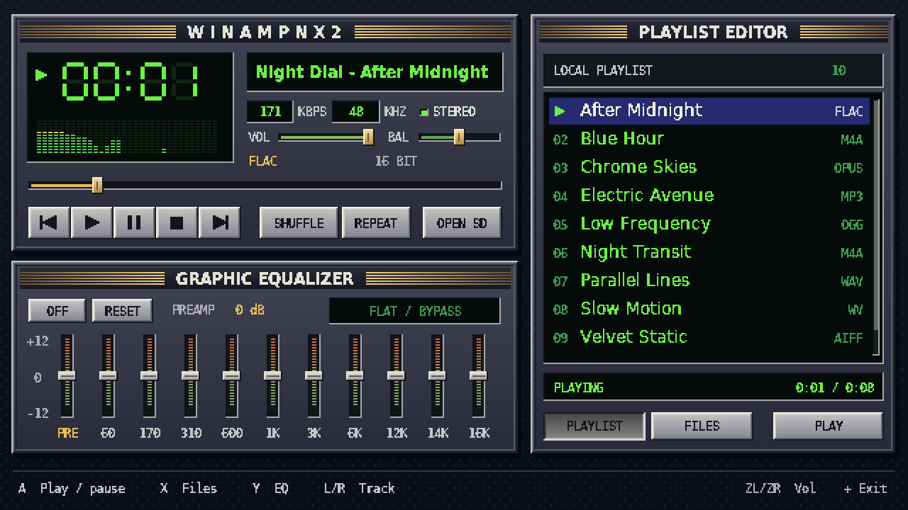
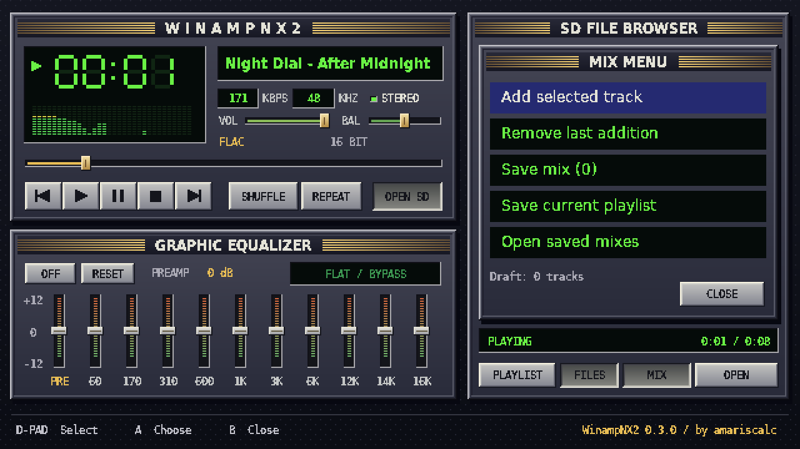
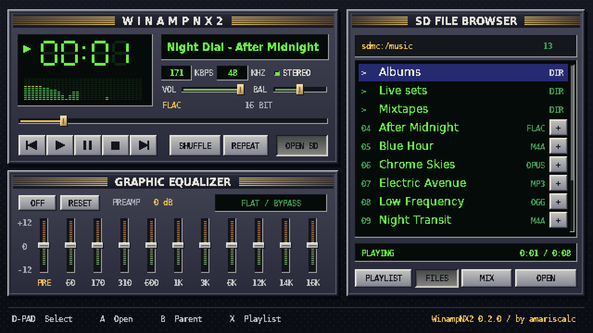

# WinampNX2

A local music player for Nintendo Switch 2 by [amariscalc](https://github.com/amariscalc). The interface takes its cues from classic Winamp: a green spectrum display, a ten-band equalizer and a docked playlist editor.



## Install

1. Download [WinampNX2.nro](dist/WinampNX2.nro) and copy it to `/switch/WinampNX2/WinampNX2.nro` on the SD card. To update, replace the existing NRO.
2. Put music in `/music/`, or press **X** in the player to browse another folder.
3. Launch WinampNX2 from hbmenu. Select a track and press **A**. Opening an audio file queues the tracks in that folder in filename order.

## Resume playback

Exit with **+** to save the playing queue, track and elapsed time. The next launch opens that track **paused**. Press **A** to continue. This works with a folder or an M3U8 mix, including repeated tracks. A stopped queue reopens with the selected row highlighted.

Sessions are saved on a normal exit to the application directory on the SD card (`/switch/WinampNX2/`). Two small files keep the latest save and its predecessor. An interrupted write can fall back to the previous complete save. Missing tracks are skipped. If the current track was removed, the next available entry is selected at the beginning, or the last surviving entry if necessary. If the queue is entirely unavailable, the player opens its usual library view.

## Mixes

Open **Files** and tap the **+** beside a track to add it to a mix. With a controller, highlight the track, press **Minus (−)** and choose **Add selected track**. Keep browsing to add songs from other folders. Additions go into a separate draft, so the current song keeps playing.

Open **MIX → Save mix** to write the draft to `/music/Playlists/Mix-001.m3u8`. Each save uses the next available number. **Open saved mixes** takes you to that folder. Choose a mix to play it in the order you added the tracks. You can rename the file on a computer.

- **Remove last addition** takes the most recently added track out of the draft.
- **Save current playlist** writes the playing queue in its listed order.
- A saved draft clears after a successful save. An unsaved draft lasts until you close the player.
- Open local `.m3u8` or UTF-8 `.m3u` files from any SD folder. Relative paths resolve from the playlist file. SD-root paths such as `/music/track.flac` and `sdmc:/music/track.flac` also work. Missing tracks are skipped. If no tracks can be opened from the list because all entries are missing or unsupported, the current queue stays in place.



## Audio

| Format | Supported files |
| --- | --- |
| Lossless | FLAC, ALAC, WavPack, Monkey’s Audio, WMA Lossless and PCM |
| Lossy | MP3, AAC, Opus, Vorbis and WMA v1/v2 |
| Containers | FLAC, MP3, raw AAC, MP4/M4A, Ogg, WAV, AIFF/AIFC, CAF, ASF/WMA, WavPack, APE and Matroska/WebM audio |

Files are decoded locally with FFmpeg. The source codec, sample rate and available title and artist tags appear in the player. Support depends on the audio stream inside each file.

AudioOut delivers **48 kHz, 16-bit stereo PCM**. Higher sample rates and bit depths are converted for output, and multichannel audio is mixed to stereo. Volume starts at 100%, balance is centered and EQ starts in bypass. Desktop tests check that 48 kHz, 16-bit stereo lossless fixtures produce the same samples as the original WAV with those settings.

## Controls

| Action | Switch 2 | Desktop |
| --- | --- | --- |
| Select a row | D-pad up/down | Up/down |
| Open selection, play or pause | A | Enter or Space |
| Browse SD / return to playlist | X | X |
| Mix menu | Minus (−) | M |
| Parent folder, close menu, leave EQ, or stop in the playlist | B | Escape |
| Seek five seconds | D-pad left/right in the playlist | Left/right |
| Previous / next track | L / R | [ / ] |
| Volume | ZL / ZR | Minus / equals |
| Shuffle / repeat playlist | Click left / right stick | S / R |
| Equalizer | Y | Y |
| Select EQ band / adjust gain | Left/right, then up/down | Arrow keys |
| Toggle EQ while focused | A | Enter |
| Exit | + | Q |

The transport buttons, browser, mix menu and sliders also accept touch input. Drag the progress slider to seek. **RESET** returns the preamp and band gains to zero.



## Build and test

For Switch 2, install devkitPro devkitA64, switch-tools and [ounce-devkit 20261117](https://github.com/ouncebrew/ounce-devkit/releases/tag/devkit-20261117). Set `DEVKITPRO` to the installation directory. The build uses Bash, Make, curl, xz and sha256sum.

```sh
make -j4 switch
sha256sum build/WinampNX2.nro
```

The first build fetches and verifies FFmpeg 7.1.5. To use a local copy, place the source archive at `build/vendor/ffmpeg-7.1.5.tar.xz` first. See the [codec build script](scripts/build-codecs.sh) and the [packaged binary checksum](dist/SHA256SUMS).

The desktop build uses C++17, pkg-config, SDL2 and FFmpeg 7 development libraries (avformat, avcodec, swresample and avutil). Tests also use the FFmpeg command-line encoder.

```sh
make desktop
./build/WinampNX2 /path/to/music
bash tests/check-audio.sh
```

The original console tests on v0.1.0 covered MP3, FLAC (16-bit/48 kHz and 24-bit/96 kHz), ALAC and Opus, automatic track changes, pause/resume and seeking. Creating, saving and reopening an M3U8 mix from the SD card has also been tested on a physical Nintendo Switch 2 with v0.2.0. On a physical Nintendo Switch 2, v0.3.0 restored the mix, track and playback position after exiting with + and reopening from hbmenu. Playback resumed from pause with A. Screenshots use the shared renderer. To capture the player, browser and mix menu, run the desktop build with `/path/to/music --capture preview`.

## Credits

Project by [amariscalc](https://github.com/amariscalc). Winamp and Nintendo Switch are trademarks of their respective owners. See [third-party notices](licenses/NOTICE.md) for FFmpeg, libounce and the embedded fonts.
